<p align="center"></p>

<h1 align="center">Inboxora</h1>

<p align="center">Self-hosted unified inbox for email, contacts and calendars.</p>

<p align="center">
  <a href="LICENSE"></a>
  
  
</p>

Inboxora brings mail, contacts and calendars into one self-hosted application. It speaks
standard protocols — IMAP, SMTP, CardDAV, CalDAV — so your data stays on your server and
your existing devices keep working.

This repository is a fork of [Dragonk/Inboxora](https://github.com/Dragonk/Inboxora-archive),
branched after its 4.0.2 release. It replaces the Node backend with a Rust server, stops copying
mailboxes into PostgreSQL, and adds two-way DAV sync, a WebDAV file explorer, scheduled and
undoable sending, invitation replies and in-browser AI. See
[What makes this fork different](#what-makes-this-fork-different) for the full list.

<p align="center">
  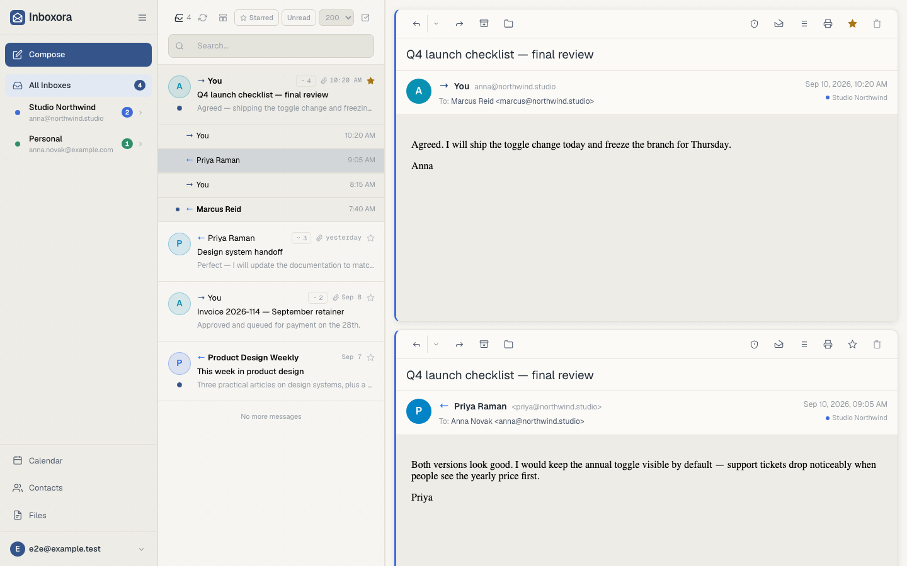
</p>

## What makes this fork different

Everything below is new relative to upstream Inboxora 4.0.2. The detailed log is in
[`docs/CHANGELOG.md`](docs/CHANGELOG.md) under *Unreleased*, and the upgrade story in
[Release notes 5.0.0 (draft)](docs/wiki/Release-notes-5.0.0.md).

### A Rust backend, one container

- **The Node backend is gone.** The server is a Rust service (axum/tokio) with its own IMAP
  client and mail engine, lettre-based SMTP, and ports of every 4.x route group. It speaks the
  same API, reads the same environment variables and migrates the same database in place, so an
  upgrade keeps sessions, accounts and data.
- **One application container.** The Rust server also serves the web app, terminates HTTPS
  (HTTP/2) with `./certs` and proxies the bundled ntfy. The separate frontend/nginx image is
  removed. The backend image is distroless and cross-compiled for amd64 and arm64.
- **Recovers on its own.** Mail server outages are retried, task panics are contained, and the
  web app shows a reconnecting screen while the backend is away.

### Live mail instead of a database copy

- **No mailbox clone in PostgreSQL.** The database keeps a header index only. Subjects, senders,
  snippets and bodies come live from IMAP and are cached in Redis and in the browser.
- **Every folder syncs on the same interval as INBOX**, including flag changes, so moves and
  reads made on other devices show up.
- See [Built for speed](#built-for-speed) for how the caches fit together.

### Mail

- **Scheduled send** behind a split send button, with edit and reschedule in the reader.
- **Undo send** as a toast, before the message leaves.
- Server-side conversation actions: delete, read and star reach the mail server.
- Newest message first in conversations, quoted history folded in many reply formats
  (German, Outlook/Exchange, localised separators), one card per expanded message.
- Starred-only filter, clickable star in list rows, optimistic moves, partial search results.
- Mail sent to **retired addresses** is tagged, and a cleanup tab lists those senders.
- Re-auth flow when an OAuth or OIDC mailbox sign-in is rejected.

### Calendar and contacts

- **Two-way CalDAV**: remote calendars can be writable, with RFC 6764 discovery, per-collection
  selection and ETag concurrency.
- **Two-way CardDAV** contacts; calendars grouped by origin.
- **Reply to invitations in the mail**: Accept, Maybe or Decline sends an RFC 5546 reply, shows
  conflicts with your calendars, and archives the message. Change the answer later from the
  calendar.
- **Attendee answers are tracked**, with address autocomplete and attendee chips. Invitations are
  Exchange-safe and only sent when something attendees see changed.
- Full-text calendar search with no date horizon, drag and resize in month view, tentative
  stripes, timed multi-day bars.

### Files

- **WebDAV file servers** with a Files explorer: columns, resizable headers, deep search,
  select mode, a server switcher and a default server.
- Attach files from a WebDAV server in the composer, or start an email from selected files.
  Files over the 25 MB limit are disabled in the picker.

### Sign-in and deployment

- **OIDC sign-in with IMAP/SMTP passthrough**: an SSO user gets a mailbox provisioned and
  authenticated with the same OAuth token (XOAUTH2/OAUTHBEARER). Providers are seeded from
  `OIDC_<N>_*` variables; `OIDC_AUTO_LOGIN` skips the login page.
- `PASSWORD_LOGIN_DISABLED=true` makes sign-in SSO-only.
- `VITE_APP_NAME` renames the app at container start, from login screen to PWA.
- `DB_HOST` accepts a PostgreSQL Unix socket path, with peer/ident authentication.
- Private mail and DAV hosts are allowed by default; `ALLOW_PRIVATE_HOSTS` overrides it.
- URL routing for mail folders, calendar and contacts, so views can be bookmarked.
- The update check and update prompts are removed.

### AI

- **Local AI in the browser** on Transformers.js, opt-in, with no provider or server needed.
- AI controls are hidden unless a provider is configured and connected.

### Not carried over

- Plugins (GTD) are not available in 5.0.0.
- CI workflows, `CONTRIBUTING.md`, `SECURITY.md`, `ROADMAP.md` and `AGENTS.md` are removed.

## Built for speed

Every layer is tuned so that a click is answered from memory, and the network only fills in
what changed. The goal: folders open instantly, messages open without a spinner, and new mail
appears without a reload.

### Where the time goes

- **One async Rust process.** axum/tokio hold every IMAP IDLE connection, sync timer and
  WebSocket in one process, with no garbage collector. HTTPS speaks HTTP/2.
- **Its own IMAP client.** CONDSTORE for cheap flag deltas, COMPRESS=DEFLATE on the wire, MOVE
  and UIDPLUS for single-round-trip moves, IDLE for INBOX and NOTIFY (RFC 5465) for every other
  folder where the server offers it.
- **Change detection, not rescans.** One `STATUS` per folder decides which folders changed.
  Only those sync. Bursts of events are debounced by 250 ms.
- **Push to the browser.** New mail, flag changes and moves arrive over a WebSocket. A list
  then asks only for `GET /api/mail/messages/changes?since=<seq>` instead of reloading.
- **Optimistic UI.** Moves, archive and delete update the list at once; the server call
  follows in the background.
- **Immutable static assets.** Hashed bundles ship with `Cache-Control: public,
  max-age=31536000, immutable`. Heavy views load as lazy chunks.
- **Never blocked by a slow server.** A list waits at most 1.5 s for IMAP. Rows still loading
  are served as placeholders and filled in by `POST /api/mail/meta` moments later.

### Three cache layers

Mail lives on the IMAP server. Inboxora never copies it into PostgreSQL. Instead, three layers
keep it close to the user:

<p align="center"></p>

| Layer | Holds | Lifetime |
| --- | --- | --- |
| Browser memory | Rows of the 12 most recent list views | Until the tab closes |
| Browser IndexedDB | Display fields, up to 2000 bodies, 200 rows per view | Bodies 7 days; all deleted on sign-out |
| Redis | Display fields (subject, sender, snippet) of every message; bodies | Display fields until the message is deleted; bodies `MAIL_BODY_TTL_SECONDS` (7 days) |
| PostgreSQL | Header index: account, folder, UID, date, flags, threading digests, snoozes, categories | Permanent |
| IMAP | The mail itself | Permanent |

A message's subject, sender and body never change, so cached copies never go stale. Only flags
and folder membership change, and those come from the header index and the change feed.

### Opening a folder

A folder you visited before renders from the browser cache in the same frame, then
revalidates in the background:

<p align="center">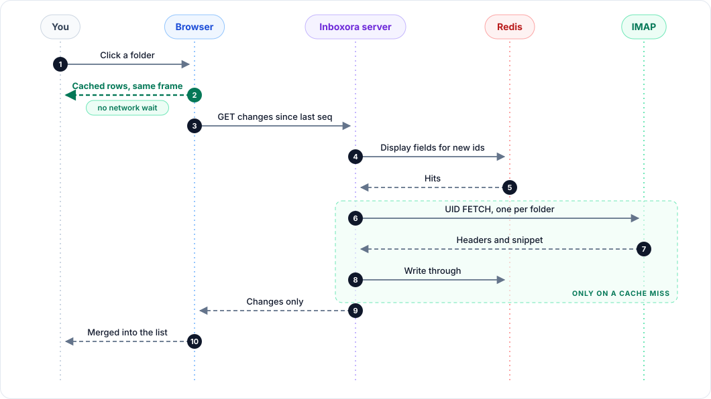</p>

Lists page by keyset cursor (`before=<date>|<id>`), so the 50th page costs the same as the
first. Search runs on the IMAP server (`UID SEARCH`) and also scans the cached display fields,
so substrings match even on servers with word-only indexes.

### Warm before you click

The server and the browser both fill caches ahead of time:

<p align="center"></p>

Browser prefetch runs at most two requests at a time and skips views fetched in the last
minute. While the server's first preload for an account runs, the web app shows a short "your
account is ready shortly" screen with progress, so the first list you see is already complete.

### Fair use of IMAP connections

Mail servers limit connections per account. Inboxora budgets them and serves the interface
first:

<p align="center"></p>

Every socket counts against `IMAP_MAX_CONNECTIONS_PER_ACCOUNT`. When a server refuses a
connection, the account's limit steps down by one, at most every 30 s and never below 2. The
learned value survives restarts; an admin can reset it under **Settings → Security → IMAP
connections**. Body fetches share a small per-account pool of logged-in connections, so opening a
message rarely waits for a fresh login.

### Tuning

| Variable | Default | Effect |
| --- | --- | --- |
| `MAIL_BODY_TTL_SECONDS` | `604800` (7 days) | How long Redis keeps message bodies. |
| `REDIS_MAXMEMORY` | `512mb` | Redis memory cap. The server warns at 80%. |
| `IMAP_MAX_CONNECTIONS_PER_ACCOUNT` | `10` | Start value of the per-account connection budget. |

Diagram sources live in [`media/diagrams/`](media/diagrams/) as Mermaid files.

Redis runs memory-only: no snapshots, no AOF, data on tmpfs. A Redis restart signs users out
and the server rebuilds the cache on its own.

## Highlights

- **Email with real threading.** Gmail, Outlook/Microsoft 365 and generic IMAP accounts feed a
  server-side conversation engine: a message and its replies become one logical conversation,
  with physical copies tracked per folder and per account. Expand a thread inline in the list,
  or read the whole conversation in the reading pane with per-message actions.
- **Calendar that works with your mail.** Local writable calendars with month, week, work-week
  and agenda views, recurring events with time-zone-aware expansion, event descriptions rendered
  like message bodies, invitations sent by email with retry, and invitations received by mail
  added to a calendar in one click.
- **Contacts with real interoperability.** Rich vCard fields, Google CSV import, Google CSV /
  Outlook CSV / vCard export, and read-only CardDAV address books.
- **CalDAV and CardDAV access through application passwords.** Dedicated, revocable app
  passwords — never your login password — so DAVx5, Thunderbird and iOS/Android clients sync
  contacts and calendars even on accounts protected by TOTP or SSO.
- **A rebuilt interface for desktop and phone.** Ink and its new Dark ink counterpart, separate
  default themes for the light and dark appearance, self-hosted fonts, resizable panels,
  drawer navigation, safe-area-aware mobile layout and system Back handling.

## Screenshots

Captured from the running application in one consistent style, on desktop (1440×900) and phone
(390×844). The complete set lives in [`media/screenshots/`](media/screenshots/) and is
generated by the Playwright documentation suite. They predate some fork changes.

### Email

On desktop, captured with the conversation expanded in the list and a message open in the reading
pane:

| Unified inbox — thread expanded, message open | Conversation reader — full thread history | Composer |
| --- | --- | --- |
|  | 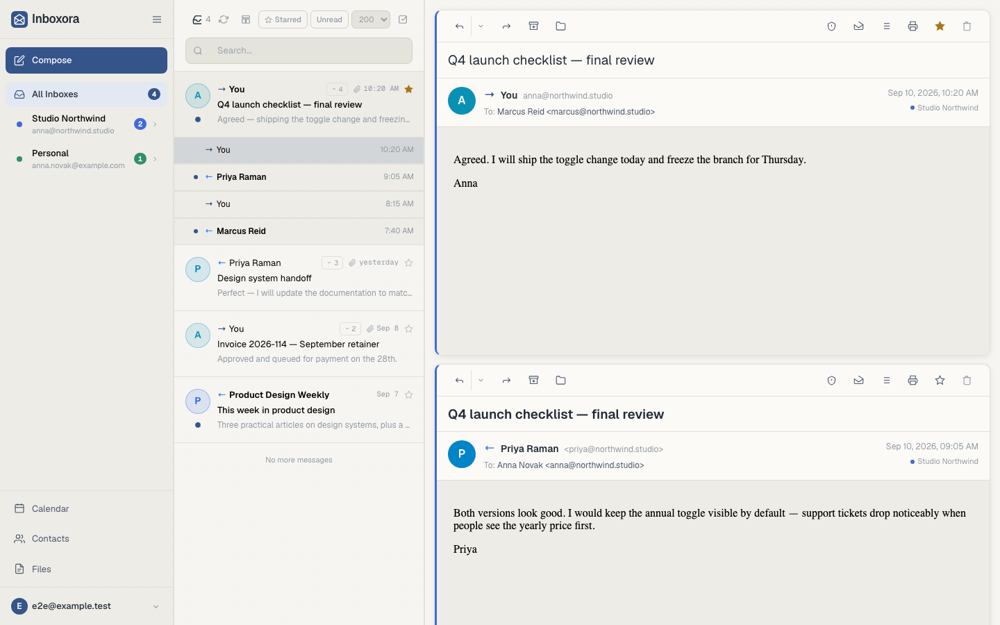 | 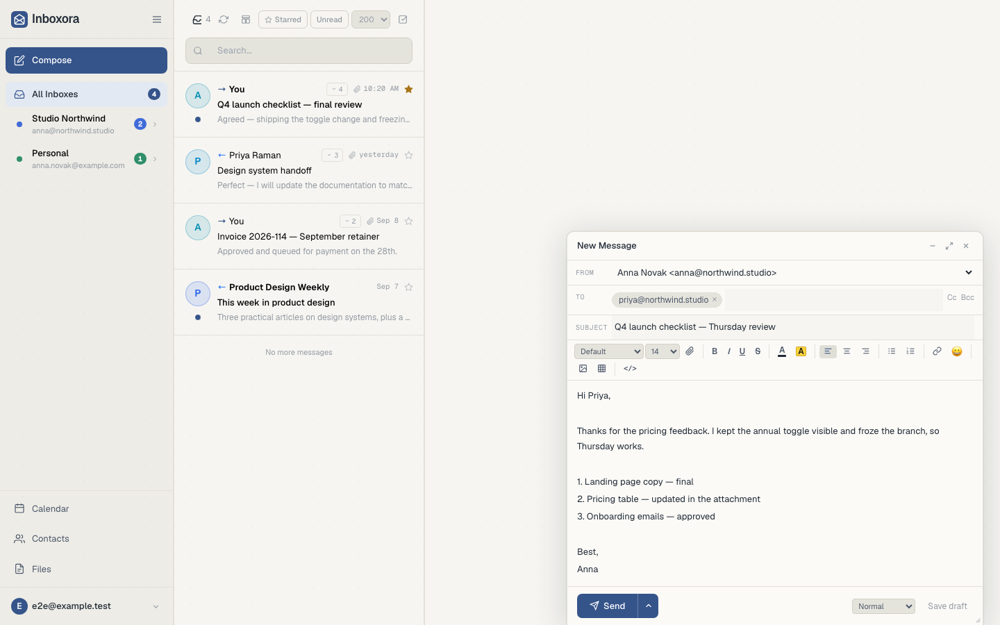 |

The same mailbox on a phone (390×844):

| Conversation reader | Composer |
| --- | --- |
|  | 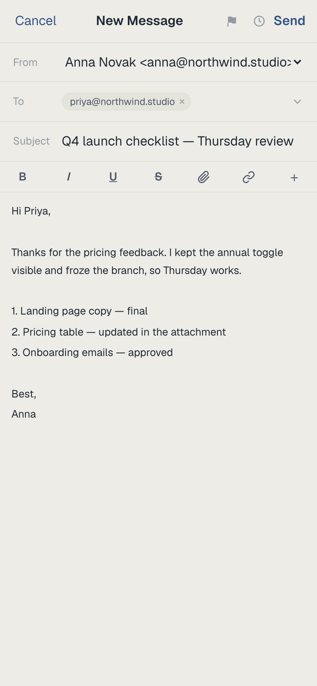 |

### Calendar

| Month | Week |
| --- | --- |
| 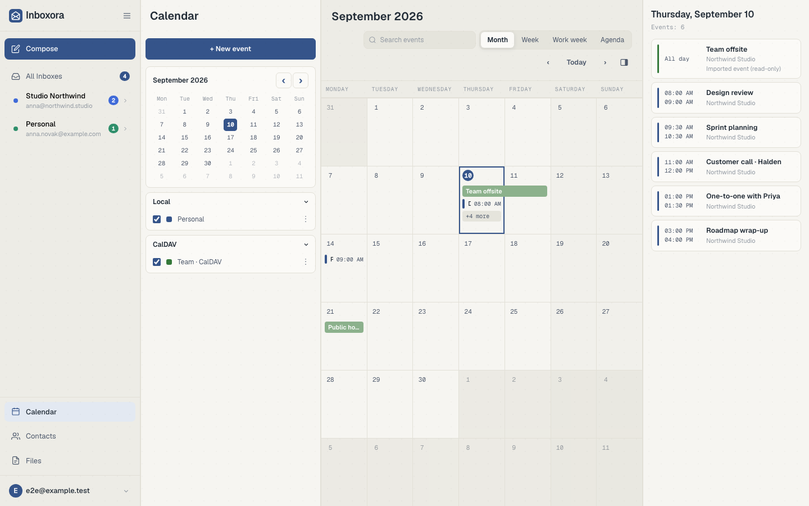 | 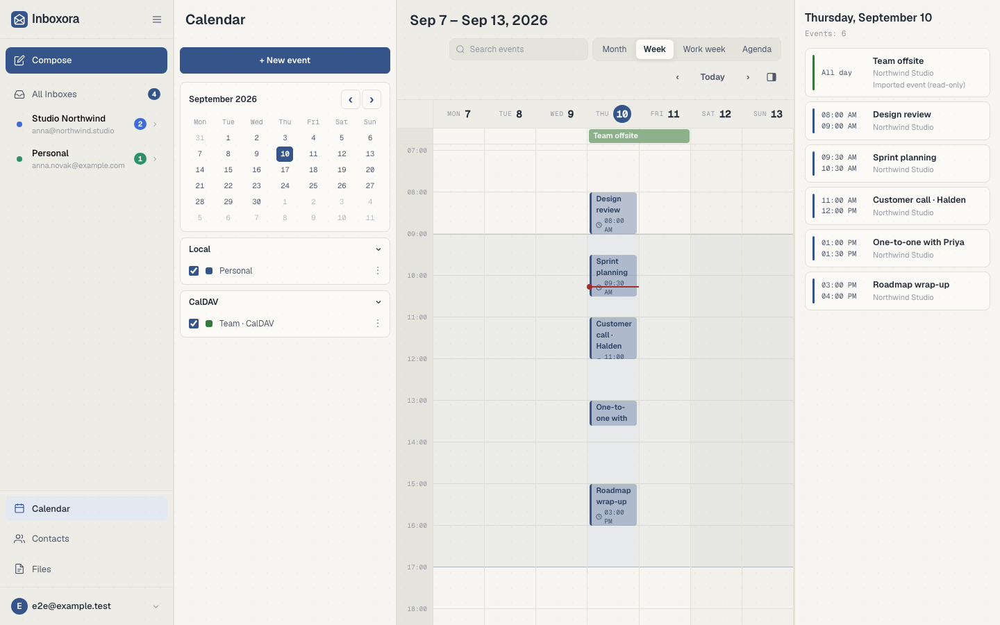 |

| Agenda | Calendar on phone |
| --- | --- |
| 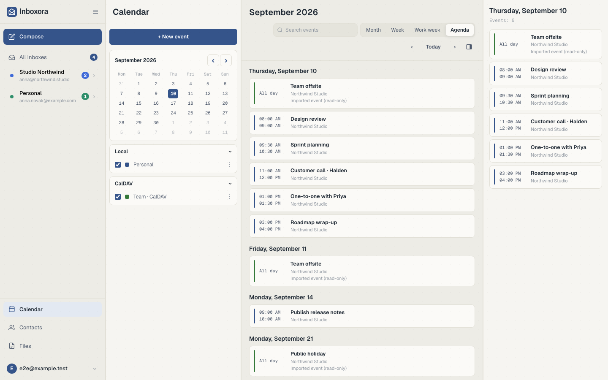 | 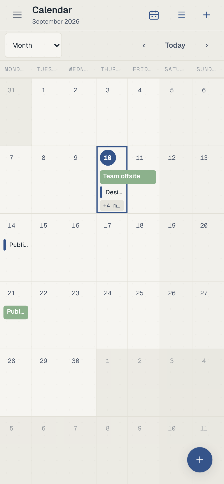 |

### Contacts

| Contact details | Rich contact editor |
| --- | --- |
| 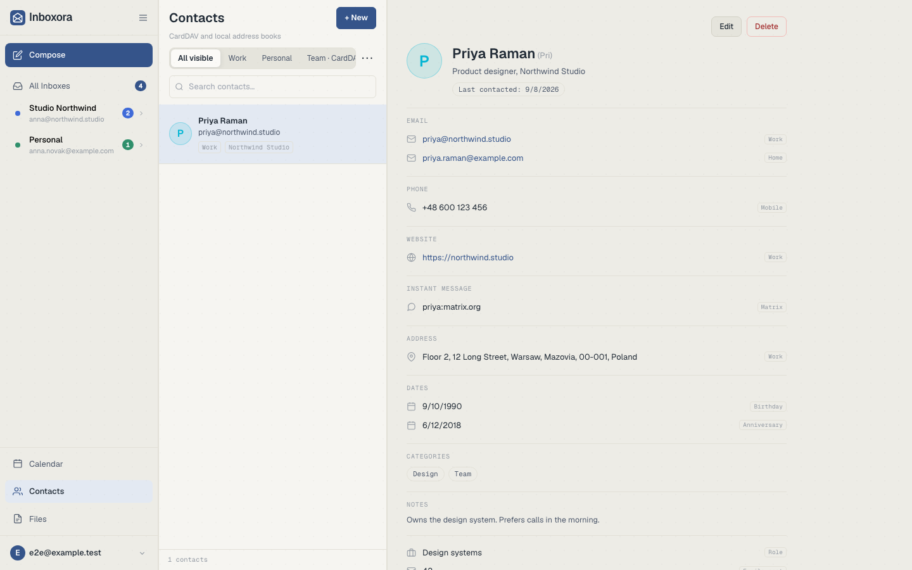 | 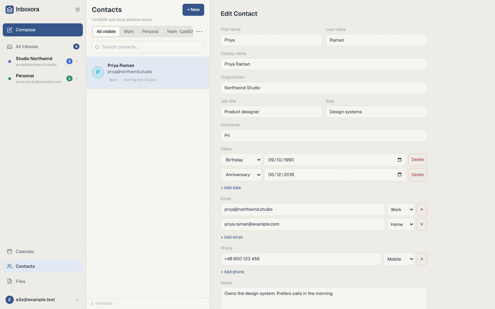 |

### Phone navigation, top or bottom

| Navigation at the top | Navigation at the bottom |
| --- | --- |
| 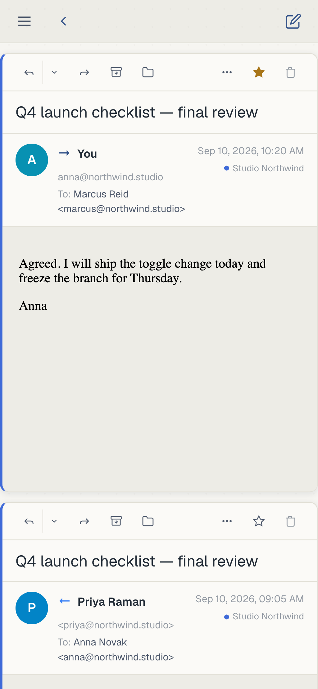 | 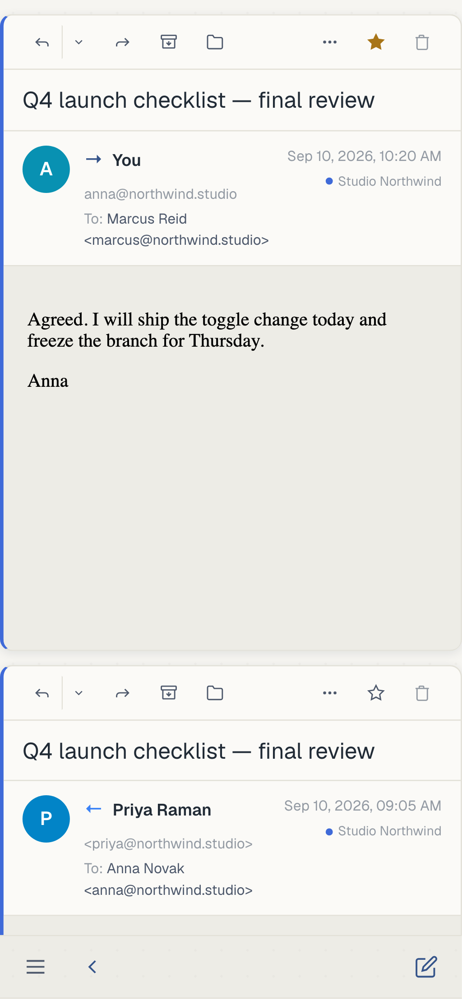 |

### DAV access

| Application passwords | On phone |
| --- | --- |
| 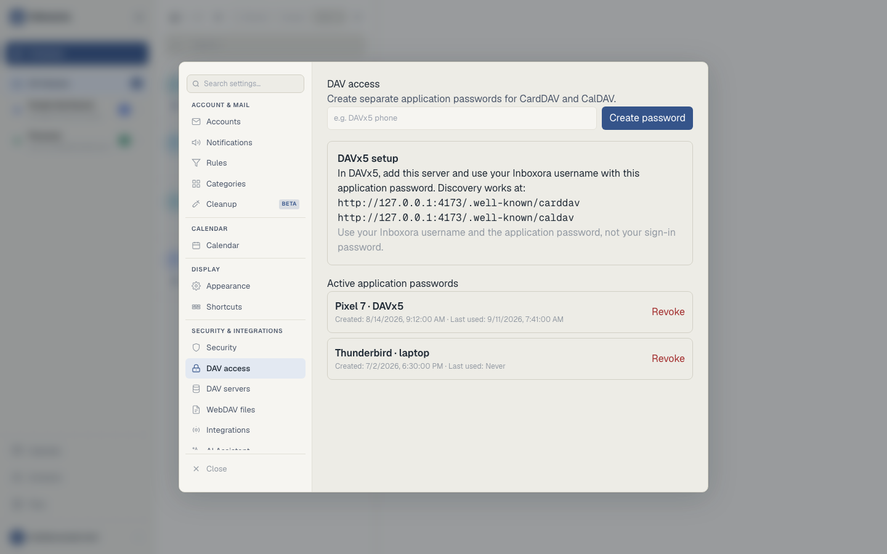 | 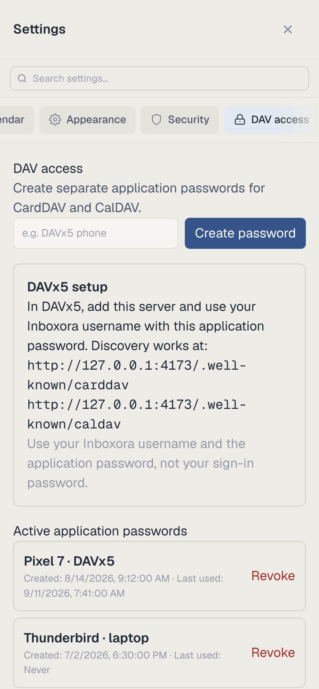 |

## What upstream 4.0 brought

This section describes upstream Inboxora 4.0, which this fork builds on. 4.0.0 is a major version because Inboxora is no longer only a mail client. Everything below
is new or rebuilt relative to the upstream MailFlow fork; the area-by-area changelog is in
[`docs/CHANGELOG.md`](docs/CHANGELOG.md), and the exhaustive per-change comparison against
upstream is published with the release tag.

- **Conversation engine.** Server-side threading with logical messages, per-folder physical
  copies, provider thread mapping (Gmail `X-GM-THRID`, Outlook `Thread-Index`, generic IMAP),
  manual merge/split/lock overrides, threading diagnostics and a dry-run rebuild.
- **Two independent threading views.** A threaded message list and a whole-conversation reader,
  each switchable on its own.
- **Calendar.** Local calendars, four views, recurrence with exceptions, event editing, email
  invitations with delivery retry, incoming invitation cards, read-only CalDAV/ICS sources and
  a generated Contact dates calendar.
- **Contacts and DAV.** First-party address books with rich vCard fields, CSV/vCard import and
  export, CardDAV server and client, CalDAV server, and revocable DAV application passwords.
- **Interface.** The Ink-based layout with resizable panels, per-module navigation, a rebuilt
  mobile shell, and self-hosted typography.
- **Platform reach.** Installable PWA with an unread badge and Web Push, a Windows Electron
  desktop application, and a native Android/Capacitor application. Android instant notifications
  use the bundled **ntfy** (UnifiedPush) server in the same stack — no Firebase, no second
  hostname. See [Platforms](#platforms) and
  [Notifications](docs/wiki/Notifications.md).

## Platforms

- **Web / PWA.** The self-hosted web app, installable from the browser, with Web Push (VAPID)
  notifications and an unread badge. Works in any modern browser.
- **Desktop.** An Electron application for Windows (the same packaging also builds Linux and
  macOS artifacts). It wraps the web app, keeps the session, and supports the host picker, tray
  and `mailto:` links.
- **Android.** A native Capacitor application with instant notifications. Android notifications
  go through **UnifiedPush**, so a compatible distributor app must be installed on the phone —
  the recommended one is **ntfy**. The Docker stack already ships the ntfy server on the same
  domain, so no second hostname or certificate is needed. Without a distributor the app still
  works and mail syncs, but notifications while the app is closed are not delivered.

See [Notifications](docs/wiki/Notifications.md) for the phone setup
and [Installation](docs/wiki/Installation.md) for the server side.

## Quick start

Docker Compose with pre-built images is the recommended deployment.

```bash
mkdir inboxora && cd inboxora
curl -o docker-compose.yml https://raw.githubusercontent.com/ftagsold/Inboxora/main/docker-compose.ghcr.yml
curl -o .env https://raw.githubusercontent.com/ftagsold/Inboxora/main/.env.example
# edit .env: APP_URL, SESSION_SECRET, DB_PASSWORD, ENCRYPTION_KEY
docker compose up -d
```

The compose file pulls `ghcr.io/ftagsold/inboxora-backend:latest`, built for amd64 and arm64.
To pin a build, set `INBOXORA_VERSION=main-<sha8>` in `.env`.

Then open `APP_URL` and create the first account. The forms need three secrets, each generated
with `openssl rand -hex 32` (or `-hex 16` for `DB_PASSWORD`):

| Variable | Purpose |
| --- | --- |
| `APP_URL` | The public URL users open; used for invitation links, OAuth callbacks and cookies. |
| `SESSION_SECRET` | Signs session cookies. |
| `DB_PASSWORD` | Password for the bundled PostgreSQL. |
| `ENCRYPTION_KEY` | Encrypts stored mail and DAV credentials at rest. **Losing it makes saved credentials unreadable.** |

Inboxora itself is a single container: the Rust server answers the API and serves the web app,
on HTTPS (`APP_PORT`, certificate from `./certs`, self-signed when absent) and plain HTTP for a
reverse proxy (`APP_HTTP_PORT`). The same `docker compose up -d` also starts **ntfy**, the
self-hosted UnifiedPush server for Android instant notifications, proxied by Inboxora on the same
domain at the `${APP_URL}` origin. One domain, one certificate, no extra configuration.

Optional: `VAPID_PUBLIC_KEY` / `VAPID_PRIVATE_KEY` / `VAPID_SUBJECT` for Web Push, and
`DOMAIN` / `ACME_EMAIL` when Inboxora terminates TLS itself. Set `PUSH_BASE_URL` plus the
`docker-compose.external-ntfy.yml` override to use your own external ntfy instead. See the
[Installation](docs/wiki/Installation.md) wiki page for the full
matrix, including running behind an existing reverse proxy.

## Coming from MailFlow?

An existing MailFlow deployment can be moved to Inboxora **without losing mail, accounts, rules,
contacts or preferences**.

> **Only MailFlow 3.3.0 is supported as a migration source.** Newer versions have not been tested.

The upgrade is a database migration that only adds: the 50 schema migrations MailFlow 3.3.0 ships
are byte-for-byte identical in Inboxora, which adds its own on top. Before you start, keep your
original `ENCRYPTION_KEY`, `DB_NAME` and `DB_USER`, and bring the stack up from the directory that
holds your volumes — Inboxora's compose file uses `inboxora` as its database default, and a new
database name on an existing volume is the usual reason a migrated instance looks empty.

The full procedure, including the in-place and dump-and-restore routes and how to group existing
mail into conversations afterwards, is in
[**Migrating from MailFlow**](docs/wiki/Migrating-from-MailFlow.md).

## Connecting your accounts

- **IMAP/SMTP** — any provider, with Gmail, Yahoo, iCloud and custom presets.
- **Gmail** — connect with a Google **app password**; Inboxora uses IMAP/SMTP with it.
- **Microsoft 365 / Outlook.com** — OAuth2 (authorization code or device code). An administrator
  registers one Azure application under **Settings → Integrations**.
- **Contacts and calendars on your devices** — generate an application password under
  **Settings → DAV access** and point DAVx5, Thunderbird or a native client at your Inboxora URL.
  Use your Inboxora username with that app password; login passwords and TOTP codes are never
  used for DAV.

## Feature tour

<details>
<summary><strong>Email</strong></summary>

- Multiple IMAP/SMTP accounts with per-account colours, sender names, aliases (send-as with
  Reply-To and per-alias signatures) and signatures.
- Unified inbox across chosen accounts, per-folder and per-account unread counts, and unified
  search across every included account.
- Native conversation threading plus a server-side conversation engine, with a threaded list
  and a whole-conversation reader as independent preferences.
- Rich or plain-text composing, reply/reply-all/forward with correct `In-Reply-To` and
  `References`, attachments and inline images, drafts saved to the IMAP Drafts folder, and
  idempotent sending that never delivers twice on a retry.
- Rules and a block list, manual spam/ham handling, one-click `List-Unsubscribe`, snooze,
  archive, move, star and bulk actions with undo.
- Full-text search with operators such as `from:`, `to:`, `subject:`, `has:attachment`,
  `is:unread`, `after:` and `before:`.
- Sandboxed HTML rendering with remote images blocked by default, an allow-list per address or
  domain, a raw-headers viewer and in-message find.
- Live updates over IMAP IDLE and a WebSocket event stream, plus optional Web Push.
- Command palette, rebindable keyboard shortcuts, and optional AI summarisation/compose help.

</details>

<details>
<summary><strong>Calendar</strong></summary>

- Month, week, work-week and agenda views with a day agenda that follows calendar visibility.
  All-day and multi-day events stretch across every day they cover in the week grids.
- Local writable calendars plus read-only calendars from CalDAV and ICS/webcal sources. A
  subscription is added by URL, or as a one-click Thunderbird public-holiday feed, from
  **Settings → Calendar**.
- Recurring events (`RRULE`, `RDATE`, `RECURRENCE-ID`, `EXDATE`) projected server-side with
  per-event time zones; editing a single occurrence preserves the series.
- Event descriptions edited as rich text and rendered through the same sanitised pipeline as
  message bodies.
- Invitations sent as an ICS email from a chosen SMTP account, with `SEQUENCE` handling,
  cancellation on attendee removal, and a retry action when delivery fails.
- Invitations received by mail surface as a card in the reader with **Add to calendar**; the
  local copy never sends an RSVP and is updated by UID and organizer.
- A generated **Contact dates** calendar turns contact birthdays and anniversaries into all-day
  yearly events, including dates stored without a year.
- Anonymous read-only `.ics` feed links that can be rotated or revoked.

</details>

<details>
<summary><strong>Contacts and DAV</strong></summary>

- Multiple local address books plus read-only CardDAV books, with visibility filters and search
  that survives switching books.
- Rich vCard fields: names, nickname, typed emails and phones, organisation, job title, role,
  URLs, instant messages, structured addresses, categories, notes, photos and multiple
  labelled dates.
- Google CSV import into local books, and Google CSV, Outlook CSV and vCard 3.0 export.
- CardDAV and CalDAV servers with `.well-known` discovery, ETag/If-Match conflict detection,
  sync tokens with tombstones and client-chosen resource filenames.
- Revocable application passwords for DAV clients, listed with creation and last-use times.
- A CardDAV client that pulls a remote server (for example Nextcloud) into read-only local books.

</details>

<details>
<summary><strong>Interface, mobile and platform</strong></summary>

- Desktop layout with independently resizable panels, shared list width across Mail, Contacts
  and Calendar, and a compact layout below 1100 layout pixels.
- Mobile shell below 767 px with a top bar, navigation drawer, floating action buttons,
  safe-area insets and system Back handling that closes in-app layers before leaving the PWA.
- Nine interface languages: English, German, French, Spanish, Italian, Russian, Chinese
  (Simplified), Polish and Czech.
- ~25 themes with a separate default for the light and the dark appearance, a theme mode that
  follows the system or forces one appearance, multiple font pairings, a font-size scale from
  80 % to 130 %, five reader layouts and configurable swipe actions. **Ink** is the default
  light theme and **Dark ink** its dark counterpart, so a fresh profile follows the system and
  switches between the two on its own.
- Installable PWA with an unread badge and push notifications, an Electron desktop application
  for Windows, and a native Android application with instant UnifiedPush (ntfy) notifications.

</details>

## Documentation

The documentation lives in [`docs/wiki/`](docs/wiki/).

| Page | Covers |
| --- | --- |
| [Installation](docs/wiki/Installation.md) | Deployment modes, secrets, reverse proxy, upgrades. |
| [Getting started](docs/wiki/Getting-started.md) | First account, first mail account, first calendar and contacts. |
| [Email and threading](docs/wiki/Email-and-threading.md) | Conversation engine, threaded list, reader, actions, search. |
| [Configuration](docs/wiki/Configuration.md) | Accounts, preferences, themes, notifications, admin tabs. |
| [Calendar](docs/wiki/Calendar.md) | Views, recurrence, invitations, visibility, sharing. |
| [Contacts and DAV](docs/wiki/Contacts-and-DAV.md) | Address books, imports/exports, CardDAV, DAVx5, app passwords. |
| [External calendars](docs/wiki/External-calendars.md) | CalDAV and ICS/webcal sources and secret feeds. |
| [Mobile navigation](docs/wiki/Mobile-navigation.md) | Phone layout, drawers, Back handling, safe areas. |
| [Security](docs/wiki/Security.md) | Secrets, network boundaries, DAV and rendering safety. |
| [Upgrading](docs/wiki/Upgrading.md) | Upgrade path, 4.0.0 notes, rollback, legacy identifiers. |
| [Migrating from MailFlow](docs/wiki/Migrating-from-MailFlow.md) | Moving a MailFlow 3.3.0 deployment to Inboxora. |
| [Troubleshooting](docs/wiki/Troubleshooting.md) | Diagnostic paths and common failures. |
| [Development](docs/wiki/Development.md) | Local verification, browser tests, documentation policy. |
| [Release notes 5.0.0 (draft)](docs/wiki/Release-notes-5.0.0.md) | The Rust backend: why it is a major release and how to upgrade. |
| [Release notes 4.0.2](docs/wiki/Release-notes-4.0.2.md) | Development release notes, rollout requirements and known status. |
| [Release notes 4.0.0](docs/wiki/Release-notes-4.0.0.md) | Why this is a major release and what changed. |

## Development

```bash
# frontend
cd frontend && npm ci && npm test && npm run lint && npm run build

# backend (Rust; see backend/README.md for the live test suites)
cd backend && cargo fmt --all --check && cargo clippy --workspace --all-targets -- -D warnings && cargo test --workspace
```

Browser coverage uses Playwright and runs the full mocked suite plus visual comparisons:
`cd frontend && npx playwright install chromium && npm run test:e2e`. Documentation screenshots
are generated on demand with `DOCS_SCREENSHOTS=1 npx playwright test e2e/docs-screenshots.spec.ts`;
see [`docs/wiki/Development.md`](docs/wiki/Development.md).

## Security

Inboxora is meant to sit behind a reverse proxy that terminates TLS; do not publish the internal
host ports directly. Keep `.env` out of source control and never paste app passwords, tokens or
deployment secrets into issues, screenshots or the docs. Report vulnerabilities privately to the
maintainer instead of opening a public issue with exploit details.

## Credits and licence

**Thanks to [maathimself](https://github.com/maathimself), creator of
[MailFlow](https://github.com/maathimself/mailflow), and to [Dragonk](https://github.com/Dragonk),
creator of [Inboxora](https://github.com/Dragonk/Inboxora-archive).** This repository is an
independently developed fork of Inboxora; the required upstream notices remain preserved.

Licensed under [AGPL-3.0-only](LICENSE). If you run a modified Inboxora as a network service, you
must offer its corresponding source to your users. Contributions are accepted under the same
terms.
